# 1. Pendahuluan

## 1.1 Latar belakang
Kriptografi menyembunyikan *isi* pesan, tetapi keberadaan ciphertext yang acak tetap menarik perhatian penyerang. Steganografi menyembunyikan *keberadaan* pesan di dalam media sampul (*cover*) seperti citra. Kedua metode saling melengkapi: pesan dienkripsi terlebih dahulu sehingga bila steganografi terbongkar, isi tetap aman; dan karena ciphertext tampak acak, ia mudah disamarkan di bit-bit kurang signifikan citra. Tugas ini mewajibkan penggabungan **tepat dua** metode dari empat pilihan (watermarking, kriptografi, steganografi, secret sharing). Sistem yang dibangun menggabungkan **Kriptografi + Steganografi** (*Enkripsi pesan, lalu sisipkan pada citra*).

## 1.2 Rumusan masalah dan tujuan
1. Bagaimana merancang pipeline yang mengintegrasikan enkripsi terautentikasi dan penyisipan LSB sehingga pesan hanya dapat diekstrak dengan password yang benar, perubahan citra tak terlihat, dan modifikasi pada stego terdeteksi?
2. Bagaimana kualitas stego-image, kapasitas, kecepatan, keamanan, serta ketahanannya terhadap serangan pada **10 payload dengan ukuran berbeda**?
3. Seberapa besar peningkatan yang diperoleh dari perbaikan desain (matrix embedding, posisi acak berkunci, ECC) dibandingkan LSB standar?

## 1.3 Batasan
Media: citra RGB/grayscale 8-bit yang disimpan sebagai PNG (lossless). Payload: byte sembarang (teks, biner, berkas). Steganalisis yang diuji: chi-kuadrat, RS analysis, dan detektor SPAM + regresi logistik; bukan detektor mutakhir berbasis deep learning.

## 1.4 Kontribusi (peningkatan dari versi awal)
| # | Peningkatan v2 | Alasan |
|---|---|---|
| 1 | **Matrix embedding** (kode Hamming, k hingga 12) | Menurunkan jumlah piksel berubah hingga ±5×, PSNR naik 2,5–6,0 dB untuk payload ≤ 25% kapasitas |
| 2 | Posisi acak dari **PRF AES-256-CTR** (bukan generator NumPy) | Generator NumPy tidak menjamin aliran yang sama antarversi; stego bisa gagal diekstrak di mesin lain. Diuji dengan *golden vector* |
| 3 | **Reed-Solomon opsional** (ECC 1–3) + header diulang 5× | Memberi ketahanan nyata terhadap noise impuls dan cropping ringan (v1: 0 dari 10 serangan lolos) |
| 4 | Header ikut diautentikasi (AAD) dan flag/panjang di-mask | Tamper pada header ikut terdeteksi; tidak ada *magic number* |
| 5 | Kompresi zlib opsional | Menaikkan kapasitas efektif untuk data yang dapat dikompresi |
| 6 | Steganalisis bertingkat: RS, χ² (kini dipakai), SPAM + ML *leave-one-cover-out* | v1 hanya RS pada satu citra |
| 7 | 8 citra sampul, uji keacakan NIST (monobit, runs, χ² byte), uji jenis payload, avalanche | Evaluasi lebih luas dan lebih jujur |
| 8 | scrypt N=2^15 (32 MiB), password via prompt/env | Biaya tebak password lebih tinggi; password tidak tersimpan di riwayat shell |
| 9 | GUI Streamlit, CLI diperluas, 18 unit test | Mudah didemokan dan diverifikasi |

# 2. Landasan teori ringkas
**AES-256-GCM** (NIST SP 800-38D) adalah enkripsi terautentikasi (AEAD): kerahasiaan lewat mode CTR dan integritas lewat tag 128 bit. **scrypt** (Percival, 2009) adalah KDF *memory-hard* yang memperlambat tebak password; **HKDF** (RFC 5869) memecah kunci induk menjadi kunci AES, kunci PRF posisi, dan mask header.

**LSB replacement** menimpa bit terakhir sehingga pasangan nilai (2k, 2k+1) menjadi seimbang dan terdeteksi uji χ² (Westfeld & Pfitzmann, 1999). **LSB matching** (Mielikäinen, 2006) menambah atau mengurangi 1 secara acak bila bit tidak cocok, sehingga tidak meninggalkan efek "tangga" pada histogram. **Matrix embedding** (Crandall, 1998; dipakai F5, Westfeld 2001) menyisipkan k bit pada grup 2^k−1 nilai dengan paling banyak 1 perubahan per grup; efisiensi naik dari 2 bit/perubahan menjadi k·2^k/(2^k−1) bit/perubahan. **Reed-Solomon** (1960) mengoreksi kesalahan simbol pada GF(2^8).

Metrik: **MSE**, **PSNR** = 10·log10(255²/MSE), **SSIM** (Wang dkk., 2004), **BER** bit tersisip, **entropi Shannon** ciphertext, uji keacakan NIST SP 800-22 (monobit, runs), uji χ² keseragaman byte, **RS analysis** (Fridrich dkk., 2001), dan fitur **SPAM** (Pevný dkk., 2010).

# 3. Rancangan sistem

## 3.1 Integrasi dua metode
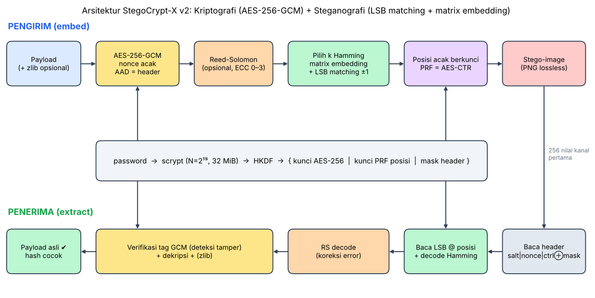

Kriptografi menghasilkan aliran bit acak yang terautentikasi, sedangkan steganografi menentukan *di mana* dan *bagaimana* bit tersebut disembunyikan. Keduanya terikat oleh satu password: dari password diturunkan kunci AES **dan** kunci posisi penyisipan, sehingga tanpa password penyerang tidak tahu posisi bit maupun cara mendekripsinya.

## 3.2 Tata letak bit
| Bagian | Isi | Letak |
|---|---|---|
| Header 256 bit | salt (16 B) \| nonce (12 B) \| ctrl (4 B) ⊕ mask | 256 nilai kanal pertama |
| ctrl | k (4 bit) \| ecc (2 bit) \| zlib (1 bit) \| rsv (1 bit) \| panjang blob (24 bit) | di-XOR mask dari HKDF |
| Body | ciphertext ‖ tag GCM (16 B), opsional dibungkus Reed-Solomon | permutasi acak berkunci (AES-256-CTR → *argsort*) |
| Mode ECC | header diulang 5× (1280 bit), dipulihkan dengan voting mayoritas | menghadapi kerusakan header |

## 3.3 Alur
**Embed:** (1) password → scrypt → HKDF → {kunci AES, kunci PRF, mask}; (2) payload → zlib (opsional) → AES-256-GCM dengan AAD = header; (3) RS encode (opsional); (4) pilih k terbesar yang muat (k=1 bila ECC aktif); (5) tentukan posisi acak berkunci; (6) sisipkan dengan matrix embedding + LSB matching ±1; (7) simpan PNG.
**Extract:** baca header → turunkan kunci → baca LSB pada posisi berkunci → decode Hamming → RS decode → verifikasi tag GCM → dekompresi. Bila ada kesalahan (password salah, tamper, kerusakan berat) sistem **menolak**, tidak pernah mengembalikan data salah.

## 3.4 Model ancaman
Penyerang boleh mengetahui algoritma (prinsip Kerckhoffs), memiliki stego, dan dapat memodifikasinya atau menjalankan steganalisis; ia tidak mengetahui password. Sasaran: kerahasiaan isi, integritas, dan ketidakterdeteksian praktis pada beban rendah-menengah.

# 4. Implementasi
Bahasa Python 3.12 (NumPy, SciPy, scikit-image/learn, OpenCV, `cryptography`, `reedsolo`, Streamlit).

| Berkas | Fungsi |
|---|---|
| `stegocrypt.py` | inti: kriptografi, ECC, matrix embedding, `embed`/`extract` |
| `metrics.py` | PSNR, SSIM, MSE, BER, entropi, NIST, RS, χ², SPAM + detektor ML |
| `attacks.py` | 16 serangan (JPEG, noise, salt & pepper, median, blur, cropping, resize) |
| `steganalysis.py`, `evaluate.py` | eksperimen dan pembuatan tabel/grafik |
| `cli.py`, `app.py` | demo terminal dan GUI interaktif |
| `tests/` | 18 unit test (roundtrip, kapasitas tepat, tamper, ECC, *golden vector* posisi) |

Parameter: scrypt N=2^15, r=8, p=1; HKDF-SHA256; nonce 96 bit acak; tag 128 bit; RS(255,223/191/127) untuk ECC 1/2/3; k maksimum 12. Demo: `python cli.py demo` atau `streamlit run app.py`.

# 5. Metodologi pengujian
* **Cover utama:** *astronaut* 512×512 RGB; kapasitas maksimum **98.256 B** (2,9985 bpp). Delapan cover lain (RGB dan grayscale) untuk uji lintas citra.
* **10 payload:** 16; 64; 256; 1.024; 4.096; 10.240; 24.576; 49.152; 73.728; dan 98.256 B (kapasitas penuh). Teks sintetis berbahasa Indonesia (entropi rendah) agar efek enkripsi terlihat; ditambah tujuh jenis payload (teks, JSON, CSV, kode, biner acak, nol, PNG).
* Setiap pengujian melewati **simpan–muat PNG** sebelum ekstraksi; keberhasilan dinilai dengan kecocokan SHA-256 dan BER bit tersisip.
* **Pembanding (ablasi):** A) LSB replace sekuensial, B) LSB replace acak berkunci, C) LSB matching acak berkunci, D) matching + matrix embedding (diusulkan).
* **Steganalisis ML:** 7 citra RGB → patch 128×128; fitur SPAM 686 dimensi; regresi logistik; validasi *leave-one-cover-out* (latih pada citra lain, uji pada citra yang tak pernah dilihat); rasio penyisipan 5–100% kapasitas.
* Waktu dirata-ratakan 3 kali; memori memakai `tracemalloc` (hanya alokasi Python/NumPy; memori scrypt di sisi C tidak terhitung).

# 6. Hasil dan pembahasan

## 6.1 Kualitas stego pada 10 payload (cover astronaut)
| Payload (B) | % kap. | k | MSE | PSNR (dB) | SSIM | PSNR LSB matching biasa (dB) | Selisih (dB) | Nilai berubah (%) | BER | Hash |
|---:|---:|---:|---:|---:|---:|---:|---:|---:|---:|:--:|
| 16 | 0,016 | 12 | 0,00020 | 85,18 | 1,00000 | 82,71 | +2,47 | 0,020 | 0 | ✔ |
| 64 | 0,065 | 12 | 0,00023 | 84,61 | 1,00000 | 80,66 | +3,94 | 0,023 | 0 | ✔ |
| 256 | 0,26 | 12 | 0,00039 | 82,19 | 1,00000 | 76,29 | +5,90 | 0,039 | 0 | ✔ |
| 1.024 | 1,04 | 9 | 0,00134 | 76,86 | 0,99999 | 70,85 | +6,01 | 0,134 | 0 | ✔ |
| 4.096 | 4,17 | 7 | 0,00610 | 70,28 | 0,99995 | 64,90 | +5,38 | 0,610 | 0 | ✔ |
| 10.240 | 10,4 | 5 | 0,0204 | 65,03 | 0,99984 | 60,96 | +4,07 | 2,04 | 0 | ✔ |
| 24.576 | 25,0 | 4 | 0,0588 | 60,43 | 0,99950 | 57,16 | +3,28 | 5,88 | 0 | ✔ |
| 49.152 | 50,0 | 2 | 0,188 | 55,40 | 0,99812 | 54,15 | +1,25 | 18,8 | 0 | ✔ |
| 73.728 | 75,0 | 1 | 0,376 | 52,38 | 0,99539 | 52,40 | −0,02 | 37,6 | 0 | ✔ |
| 98.256 | 100 | 1 | 0,500 | 51,14 | 0,99319 | 51,14 | 0,00 | 50,0 | 0 | ✔ |

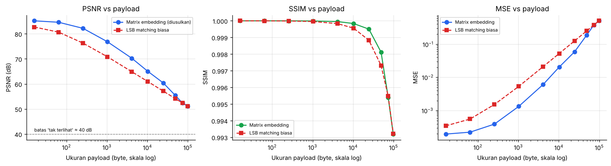

**Pembahasan.** Seluruh 10 payload terekstraksi identik (hash cocok, BER = 0). PSNR berada jauh di atas ambang "tak terlihat" ±40 dB, bahkan pada kapasitas penuh (51,14 dB). Matrix embedding memberi keuntungan terbesar pada payload kecil-menengah (hingga +6,0 dB, jumlah nilai berubah turun ±5×). Pada ≥75% kapasitas k turun menjadi 1 sehingga tidak ada keuntungan: ini batas teoretis kode Hamming, bukan kekurangan implementasi.

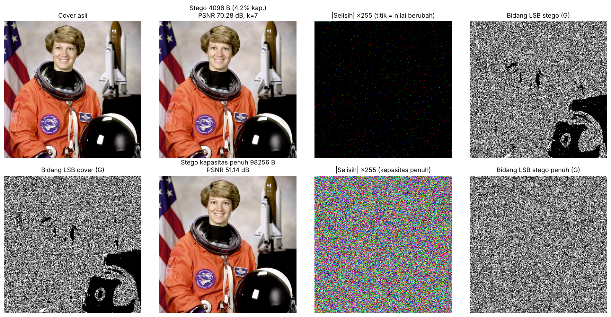

## 6.2 Performa dan overhead
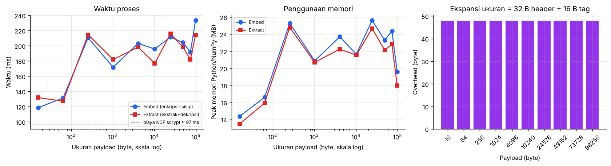

Waktu embed 119–234 ms dan ekstraksi 127–216 ms, hampir seluruhnya biaya KDF scrypt (±97 ms) ditambah pembangkitan permutasi; waktu relatif datar terhadap ukuran payload. Puncak memori Python/NumPy 14–26 MB. Ekspansi ukuran **konstan 48 B** (32 B header + 16 B tag), jadi tidak bergantung pada payload. Ukuran berkas PNG stego naik dari 414,6 KB (cover) menjadi 415,2 KB pada 1 KB payload dan 442,6 KB (+6,8%) pada kapasitas penuh.

## 6.3 Analisis kriptografi
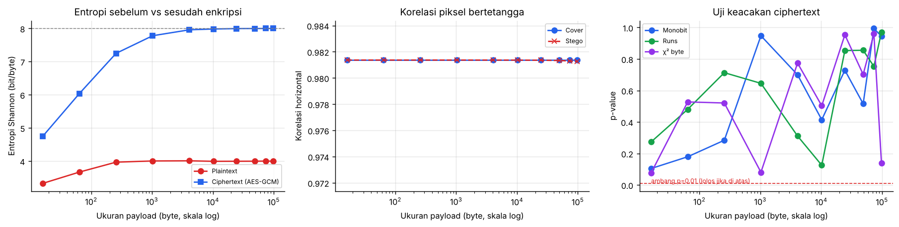

* Entropi ciphertext 7,957–7,998 bit/byte untuk payload ≥ 4 KB (plaintext ±4,0). Pada payload sangat kecil entropi dibatasi ukuran sampel (maksimum log₂ n; mis. 32 B → 5 bit), bukan kelemahan cipher.
* Seluruh uji NIST lolos pada α = 0,01: p-value monobit terkecil 0,104, runs 0,125, χ² byte 0,076.
* **Independen dari jenis payload:** pada payload 4 KB berupa teks, JSON, CSV, kode, biner acak, nol semua, dan PNG, entropi ciphertext 7,949–7,963 dan p-value χ² 0,09–0,98; PSNR sama (70,28 dB) karena yang disisipkan selalu ciphertext.
* **Avalanche kunci:** mengubah 1 karakter password mengubah **49,93% ± 1,07%** bit ciphertext. Mengubah 1 bit plaintext hanya mengubah 1 bit ciphertext (sifat mode CTR), tetapi **50,8%** bit tag berubah, sehingga manipulasi terdeteksi.

## 6.4 Kapasitas dan uji lintas citra
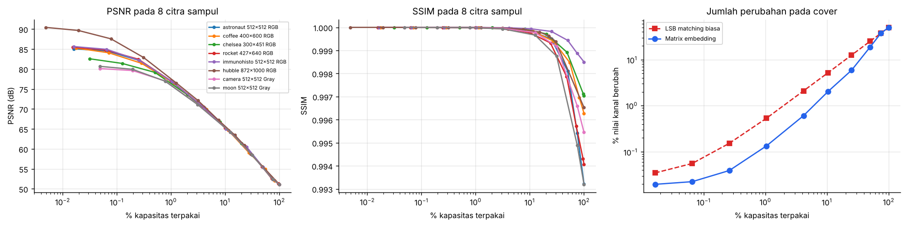
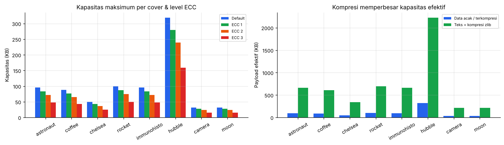

Sebanyak 77 pengujian pada 8 cover (RGB dan grayscale) seluruhnya pulih identik; PSNR pada kapasitas penuh 51,13–51,16 dB di semua cover, sehingga kualitas ditentukan rasio kapasitas, bukan isi citra. Kapasitas ±3,0 bpp (RGB) dan ±1,0 bpp (grayscale). ECC menukar kapasitas dengan ketahanan: untuk astronaut 98.256 B (tanpa ECC) → 85.808 / 73.488 / 48.848 B (ECC 1/2/3). Kompresi zlib menaikkan kapasitas efektif ±6,9× pada korpus teks sintetis kami; angka ini batas atas karena kosakata korpus hanya 30 kata, sedangkan teks nyata umumnya terkompresi ±2–4×.

## 6.5 Steganalisis
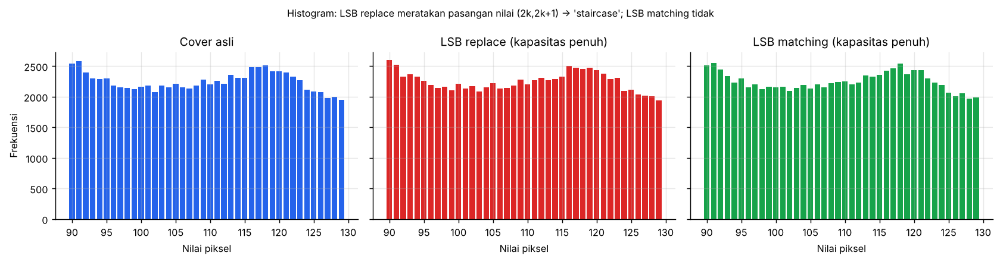
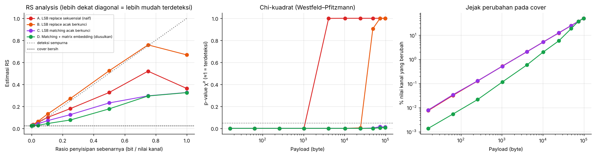

* **χ² (Westfeld–Pfitzmann):** skema A terdeteksi (p ≈ 1) mulai payload 4 KB; skema B mulai 48 KB. Skema C dan D tidak pernah melewati p = 0,05 (maks. 0,015 dan 0,007), jadi pasangan nilai tidak terekualisasi.
* **RS analysis:** estimasi untuk cover bersih 0,0245. Pada 4 KB: A 0,057; B 0,064; C 0,041; D **0,028** (hampir tak dapat dibedakan dari cover). Estimator RS jenuh di rasio mendekati 1 sehingga nilai di sana tidak berarti "tak terdeteksi".

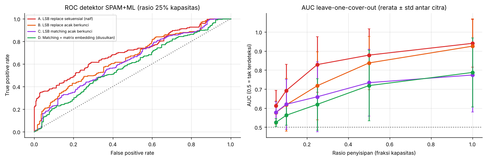

| Rasio kapasitas | A. replace sekuensial | B. replace acak | C. matching acak | **D. matching + matrix** |
|---:|---:|---:|---:|---:|
| 5% | 0,613 | 0,577 | 0,578 | **0,525** |
| 10% | 0,692 | 0,617 | 0,620 | **0,562** |
| 25% | 0,829 | 0,717 | 0,660 | **0,620** |
| 50% | 0,878 | 0,837 | 0,734 | **0,718** |
| 100% | 0,940 | 0,925 | 0,774 | 0,787 |

*AUC detektor SPAM + regresi logistik, rerata leave-one-cover-out (0,5 = tak terdeteksi); simpangan baku antarcitra 0,02–0,19.* Skema A paling mudah terdeteksi dan skema D paling sulit pada semua rasio ≤ 50% (B dan C berdekatan pada 5–10%). Pada 100% D ≡ C (k=1), selisih 0,013 adalah derau. Simpangan baku besar karena hanya ada 7 citra, sehingga kesimpulannya adalah **kecenderungan**, bukan bukti statistik kuat. Detektor yang dipakai juga lebih sederhana daripada SRM/CNN; AUC yang lebih rendah di sini **bukan jaminan** tak terdeteksi oleh detektor modern.

## 6.6 Robustness
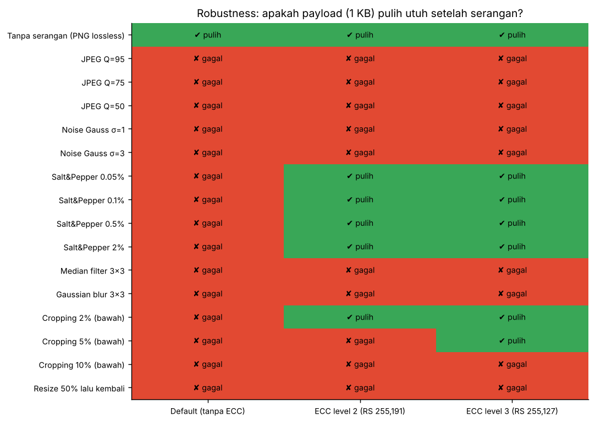

| Serangan | Default | ECC 2 | ECC 3 |
|---|:--:|:--:|:--:|
| Tanpa serangan (PNG) | ✔ | ✔ | ✔ |
| Salt & pepper 0,05% – 2% | ✘ | ✔ | ✔ |
| Cropping 2% (area dihitamkan) | ✘ | ✔ | ✔ |
| Cropping 5% | ✘ | ✘ | ✔ |
| Cropping 10%, JPEG Q95/75/50, noise Gauss σ=1/3, median, blur, resize 50% | ✘ | ✘ | ✘ |

LSB secara inheren rapuh: JPEG dan filter mengacak bit terakhir (BER ≈ 0,5). Mode default sengaja mengutamakan kapasitas dan kualitas. Dengan ECC 2–3 payload bertahan dari noise impuls dan cropping ringan. Temuan penting: **matrix embedding memperbesar galat bit** (salt & pepper 0,05% menghasilkan BER 5,3% pada mode default, karena 1 LSB yang rusak mengubah syndrome grup sehingga merusak sampai k bit), maka mode ECC memaksa k = 1. Ketahanan terhadap JPEG/filter membutuhkan penyisipan pada domain transformasi (DCT/DWT), di luar cakupan tugas ini. Cropping di sini berarti area dihitamkan; cropping yang mengubah dimensi tidak didukung karena posisi bergantung ukuran citra.

## 6.7 Keamanan
| Uji | Hasil |
|---|---|
| Password salah (50 tebakan) | ditolak 50/50 |
| Tamper 1 bit LSB (30 posisi acak, tanpa ECC) | terdeteksi 30/30 |
| Tamper 1 bit dengan ECC 3 | dikoreksi, payload utuh 30/30 |
| Kerusakan 20% LSB dengan ECC 3 | ditolak 30/30; **data salah yang diterima: 0** |
| Biaya tebak password | ±97 ms/tebakan, ≈10,3 tebakan/detik/inti |

Estimasi *brute force* (rata-rata setengah ruang pencarian):

| Ruang password | Kombinasi | 1 inti | 10⁶ inti |
|---|---:|---:|---:|
| PIN 6 digit | 1,0×10⁶ | ±13,5 jam | < 1 detik |
| 8 huruf kecil | 2,1×10¹¹ | 322 tahun | ±2,8 jam |
| 8 alfanumerik | 2,2×10¹⁴ | 3,4×10⁵ tahun | 0,34 tahun |
| 12 alfanumerik | 3,2×10²¹ | 5,0×10¹² tahun | 5,0×10⁶ tahun |
| Passphrase 5 kata diceware | 2,8×10¹⁹ | 4,4×10¹⁰ tahun | 4,4×10⁴ tahun |

Password pendek tetap rentan; rekomendasi: passphrase ≥ 5 kata atau ≥ 12 karakter acak. Untuk produksi, N scrypt sebaiknya dinaikkan (mis. 2^17, sesuai pedoman OWASP) dengan konsekuensi waktu proses.

## 6.8 Ancaman terhadap validitas dan keterbatasan
* Cover berasal dari galeri `scikit-image` (citra baku), bukan koleksi besar seperti BOSSbase; hasil steganalisis ML berdasar 7 citra.
* Waktu diukur pada satu mesin tanpa isolasi beban; memori hanya alokasi Python/NumPy.
* Payload sintetis memudahkan pengamatan efek enkripsi; uji jenis payload mengurangi bias ini.
* Tidak ada pengujian terhadap steganalisis mutakhir (SRM, CNN) maupun serangan *known-cover*.
* Penyisipan di domain spasial; tidak tahan kompresi lossy.

# 7. Kesimpulan dan saran
1. Sistem Kriptografi + Steganografi berjalan end-to-end dan didemokan lewat CLI dan GUI; seluruh **10 payload (16 B–98.256 B)** pulih identik (hash cocok, BER = 0) dan 77 pengujian lintas 8 cover juga lolos.
2. Kualitas sangat baik: PSNR 85,2 → 51,1 dB dan SSIM ≥ 0,993 dari payload terkecil hingga kapasitas penuh.
3. Matrix embedding meningkatkan PSNR hingga +6,0 dB dan menurunkan jumlah perubahan ±5× pada payload ≤ 50% kapasitas, serta menurunkan AUC detektor SPAM + ML pada rasio ≤ 50% (kecenderungan, bukan bukti kuat).
4. Keamanan: password salah ditolak 50/50, tamper terdeteksi 30/30, tidak pernah mengembalikan data salah; ciphertext lolos uji keacakan.
5. Robustness LSB terbatas; ECC memberi ketahanan nyata hanya pada noise impuls dan cropping ringan, dengan harga kapasitas 14–50%.

**Saran:** penyisipan domain DCT/DWT untuk ketahanan JPEG; penyisipan adaptif berbasis tekstur (HUGO/WOW/S-UNIWARD); uji steganalisis SRM/CNN pada BOSSbase; menambahkan kombinasi *secret sharing* sebagai pengembangan lanjutan.

# Referensi
1. M. Dworkin, *Recommendation for Block Cipher Modes of Operation: Galois/Counter Mode (GCM) and GMAC*, NIST SP 800-38D, 2007.
2. C. Percival, "Stronger Key Derivation via Sequential Memory-Hard Functions," BSDCan, 2009.
3. H. Krawczyk dan P. Eronen, *HMAC-based Extract-and-Expand Key Derivation Function (HKDF)*, RFC 5869, 2010.
4. J. Mielikäinen, "LSB Matching Revisited," *IEEE Signal Processing Letters*, vol. 13, no. 5, hlm. 285–287, 2006.
5. R. Crandall, "Some Notes on Steganography," Steganography Mailing List, 1998.
6. A. Westfeld, "F5 — A Steganographic Algorithm," *Information Hiding*, LNCS 2137, hlm. 289–302, 2001.
7. A. Westfeld dan A. Pfitzmann, "Attacks on Steganographic Systems," *Information Hiding*, LNCS 1768, hlm. 61–76, 2000.
8. J. Fridrich, M. Goljan, dan R. Du, "Detecting LSB Steganography in Color and Gray-Scale Images," *IEEE MultiMedia*, vol. 8, no. 4, hlm. 22–28, 2001.
9. T. Pevný, P. Bas, dan J. Fridrich, "Steganalysis by Subtractive Pixel Adjacency Matrix," *IEEE Trans. Information Forensics and Security*, vol. 5, no. 2, hlm. 215–224, 2010.
10. Z. Wang, A. C. Bovik, H. R. Sheikh, dan E. P. Simoncelli, "Image Quality Assessment: From Error Visibility to Structural Similarity," *IEEE Trans. Image Processing*, vol. 13, no. 4, hlm. 600–612, 2004.
11. I. S. Reed dan G. Solomon, "Polynomial Codes over Certain Finite Fields," *J. SIAM*, vol. 8, no. 2, hlm. 300–304, 1960.
12. A. Rukhin dkk., *A Statistical Test Suite for Random and Pseudorandom Number Generators for Cryptographic Applications*, NIST SP 800-22 Rev. 1a, 2010.
13. C. E. Shannon, "A Mathematical Theory of Communication," *Bell System Technical Journal*, vol. 27, 1948.
14. N. Provos dan P. Honeyman, "Hide and Seek: An Introduction to Steganography," *IEEE Security & Privacy*, vol. 1, no. 3, hlm. 32–44, 2003.

# Lampiran A. Cara menjalankan
```
pip install -r requirements.txt
python cli.py demo                         # demo terminal
streamlit run app.py                       # demo GUI
python -m unittest discover -s tests -v    # 18 unit test
python evaluate.py                         # seluruh eksperimen (±8 menit)
```
Seluruh tabel mentah ada di `results/*.csv` dan grafik di `figures/*.png`.
